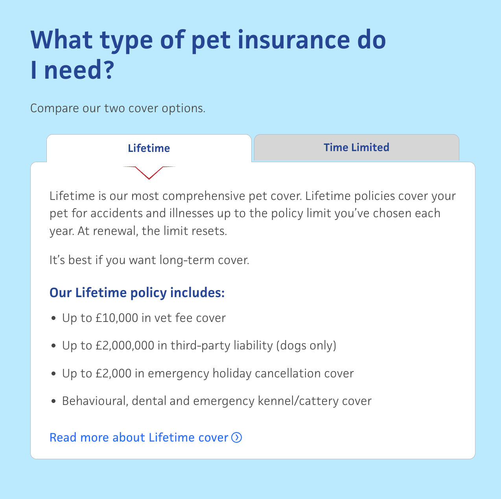
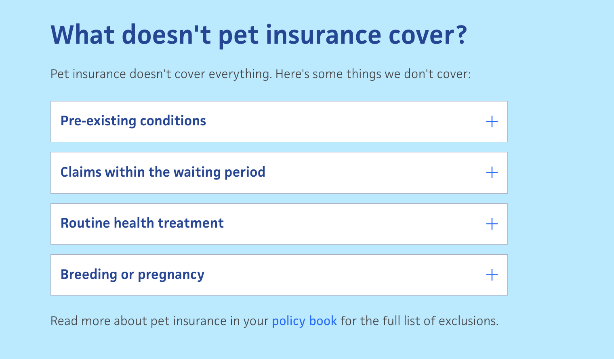

# Admiral Car Insurance Functional Spec

Source page: <https://www.admiral.com/car-insurance>

## Instructions

- Re-use blocks where appropriate. For other parts on the page make a judgement call.
- Also create the child content pages used on this page, similar to previous imports.
- Create the fragments, images and content pages into a JCR package for import. Do not touch the assets, fragments or content pages already migrated.

## Section Mapping (Output → Desired Authoring)

| # | Output (screenshot) | Desired Authoring |
|---|---|---|
| 1 |  | Hero block |
| 2 |  | Trustpilot block |
| 3 |  | Content Fragment block |
| 4 |  | Content Fragment block |
| 5 |  | Content Fragment block |
| 6 |  | Content Fragment block |
| 7 |  | Content Fragment block The table needs to be driven by content fragments but also easy to manage and author |
| 8 |  | Card folder block |
| 9 |  | Content Fragment block |
| 10 |  | Carousel block |
| 11 |  | Content fragment block |
| 12 |  | Content fragment block the arrows change to face downwards when the screen size is reduced |
| 13 |  | Card folder block |
